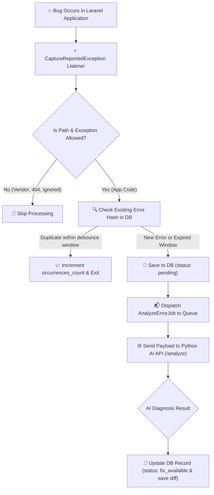

<div align="center">

# 🛠️ Laravel AI Bug Fixer

<p align="center">
  <strong>Automated error detection, intelligent context extraction, and AI-assisted code repair for Laravel.</strong>
</p>
</div>

---

## 📖 Table of Contents

- [What is Laravel AI Bug Fixer?](#-what-is-laravel-ai-bug-fixer)
- [Why Use This Package?](#-why-use-this-package)
- [Prerequisites](#-prerequisites)
- [Step-by-Step Installation Guide (Beginner Friendly)](#-step-by-step-installation-guide-beginner-friendly)
  - [Step 1: Open Terminal in Project Folder](#step-1-open-terminal-in-project-folder)
  - [Step 2: Install via Composer](#step-2-install-via-composer)
  - [Step 3: Publish Configuration File](#step-3-publish-configuration-file)
  - [Step 4: Run Database Migrations](#step-4-run-database-migrations)
  - [Step 5: Update Your `.env` File](#step-5-update-your-env-file)
  - [Step 6: Test the Connection](#step-6-test-the-connection)
  - [Step 7: Ensure Your Queue Worker is Running](#step-7-ensure-your-queue-worker-is-running)
- [Database Storage & Smart Deduplication](#-database-storage--smart-deduplication)
- [How It Works (Visual Workflow)](#-how-it-works-visual-workflow)
- [Configuration Reference](#-configuration-reference)
- [Privacy & Security by Default](#-privacy--security-by-default)
- [Testing the Package](#-testing-the-package)
- [Frequently Asked Questions (Troubleshooting)](#-frequently-asked-questions-troubleshooting)
- [Python AI Service Specification (For Backend Engineers)](#-python-ai-service-specification-for-backend-engineers)
- [Local Python AI Service & MCP Server](#-local-python-ai-service--mcp-server)
- [Contributing](#-contributing)
- [License](#-license)

---

## 💡 What is Laravel AI Bug Fixer?

In plain English: **Whenever a bug or crash happens in your Laravel website or application, this package automatically captures the error, removes sensitive data (like passwords and credit cards), grabs the code surrounding the error, and asks an AI service for the exact root cause and suggested fix.**

Instead of spending hours searching through confusing log files, you get actionable AI suggestions explaining what went wrong and how to fix the code.

---

## ✨ Why Use This Package?

- 🛡️ **Zero-Leak Security**: Automatically redacts passwords, tokens, API keys, cookies, and credit cards before anything leaves your server.
- ⚡ **Zero Performance Lag**: Analyzes errors asynchronously in background queues so website visitors never experience slow page loads.
- 🔍 **Rich Context Extractor**: Captures 10 lines of code before and after the crash line so the AI model sees the full picture.
- 🔁 **Infinite-Loop Prevention**: Built-in recursion guards ensure that an error during diagnosis never crashes your application.
- 🎯 **Smart Noise Filtering**: Automatically ignores routine HTTP 404 (Not Found) errors, validation errors, and vendor libraries.
- 🧪 **One-Command Health Check**: Includes a built-in `php artisan ai-bug-fixer:test` command to verify connectivity instantly.

---

## 📋 Prerequisites

Before installing, make sure your environment meets the following requirements:

| Requirement | Supported Versions | Notes |
| :--- | :--- | :--- |
| **PHP** | `8.2` or higher | Check with `php -v` |
| **Laravel** | `10.x`, `11.x`, or `12.x` | Check with `php artisan --version` |
| **Composer** | `2.x` | Check with `composer -v` |
| **AI Service** | Running endpoint | A Python AI service (e.g., `http://127.0.0.1:8001`) |

---

## 🚀 Step-by-Step Installation Guide (Beginner Friendly)

Follow these easy steps to get up and running in under 3 minutes.

### Step 1: Open Terminal in Project Folder

Open your terminal or command prompt (Terminal on macOS/Linux, PowerShell or Git Bash on Windows), and navigate into your Laravel project directory:

```bash
cd /path/to/your-laravel-project
```

---

### Step 2: Install via Composer

Run the following command to download and add the package to your project:

```bash
composer require acquaint/laravel-ai-bug-fixer
```

> 💡 **What this does:** Composer downloads the package code and registers the service provider with Laravel automatically.

---

### Step 3: Publish Configuration File

Run this Artisan command to copy the package's default configuration into your Laravel `config` directory:

```bash
php artisan vendor:publish --tag=ai-bug-fixer-config
```

> 💡 **What this does:** This creates a new file at `config/ai-bug-fixer.php`. You can inspect and adjust settings there anytime.

---

### Step 4: Run Database Migrations

Run Laravel's migration command to create the `ai_bug_fixer_errors` table:

```bash
php artisan migrate
```

> 💡 **What this does:** This creates the database table used to store bug history, AI fix summaries, code diffs, and occurrence counts so you never lose diagnosis results.

*(Optional)* If you want to customize the migration file before migrating:
```bash
php artisan vendor:publish --tag=ai-bug-fixer-migrations
```

---

### Step 5: Update Your `.env` File

Open the `.env` file located in the root directory of your Laravel project (using VS Code, PHPStorm, Sublime, or any text editor). 

Add the following lines at the bottom of your `.env` file:

```env
# --------------------------------------------------------------------------
# Laravel AI Bug Fixer Configuration
# --------------------------------------------------------------------------

# Set to true to activate automated error analysis
AI_BUG_FIXER_ENABLED=true

# The URL of your Python AI service (change port or domain if needed)
AI_BUG_FIXER_PYTHON_URL=http://127.0.0.1:8001

# (Optional) Secret API token if your Python service requires authentication
AI_BUG_FIXER_API_KEY=

# (Optional) Dedicated queue name for processing error analysis jobs
AI_BUG_FIXER_QUEUE=ai-bug-fixes
```

#### 🔍 What Each Setting Means:

- **`AI_BUG_FIXER_ENABLED`**: Default is `false`. Change this to `true` to enable error capturing.
- **`AI_BUG_FIXER_PYTHON_URL`**: The web address where your AI service is running. If running locally, `http://127.0.0.1:8001` is standard.
- **`AI_BUG_FIXER_API_KEY`**: If your AI service uses a Bearer token or API key for security, paste it here. Otherwise, leave it blank.
- **`AI_BUG_FIXER_QUEUE`**: The name of the Laravel queue used to process errors in the background (default: `ai-bug-fixes`).

---

### Step 6: Test the Connection

Verify that your Laravel app can communicate with your Python AI service by running:

```bash
php artisan ai-bug-fixer:test
```

#### ✅ If Everything is Working:
You will see output similar to this:
```text
Testing connection to AI Bug Fixer Python service at: http://127.0.0.1:8001
Sending probe request to /analyze endpoint... SUCCESS
Response time: 42.15ms
Service status: fix_available
```

#### ❌ If the Connection Fails:
```text
Sending probe request to /analyze endpoint... FAILED
Connection failed: Connection refused
Please check that the Python service is running and accessible at: http://127.0.0.1:8001
```
> ⚠️ **How to fix:** Ensure that your Python AI service is started and listening on the URL and port defined in your `AI_BUG_FIXER_PYTHON_URL`.

---

### Step 7: Ensure Your Queue Worker is Running

Because the package processes error reports in the background so that your users never experience slowdowns, your Laravel queue worker must be running.

#### In Local Development:
Run the queue worker in a separate terminal window:
```bash
php artisan queue:work --queue=ai-bug-fixes
```

> 💡 **Quick Tip for Local Testing:** If you do not want to run a queue worker during local development, open your `.env` file and set:
> ```env
> QUEUE_CONNECTION=sync
> ```
> This causes Laravel to process queue jobs immediately without needing a separate worker.

#### In Production:
Use a process manager like **Supervisor** or Laravel Horizon to keep `php artisan queue:work --queue=ai-bug-fixes` running continuously in the background.

---

## 🗄️ Database Storage & Smart Deduplication

### Handling Error Spikes & Duplicate Errors
If 50 users hit the same broken route within 10 seconds, traditional error loggers flood your queue with 50 duplicate requests, draining AI API tokens.

**Laravel AI Bug Fixer handles this automatically:**
1. **Fingerprint Hash**: Calculates a unique fingerprint hash (`sha256`) based on the exception class, source file, and line number.
2. **Occurrence Counter**: When a known error occurs repeatedly within the debounce window (default: 15 minutes), the package increments `occurrences_count` in the database and updates `last_seen_at`.
3. **Queue Throttling**: It avoids queueing duplicate requests to the Python AI service if an analysis is already pending, in progress, or recently completed.
4. **Persistent History**: The Eloquent model `Acquaint\AiBugFixer\Models\AiError` stores the complete history, status (`pending`, `analyzing`, `fix_available`, `no_fix_found`, `error`), AI summary, and generated code patches.

---

## 🔄 How It Works (Visual Workflow)



---

## ⚙️ Configuration Reference

All settings can be customized in `config/ai-bug-fixer.php` or overridden via `.env`:

| Setting | Environment Variable | Default Value | Description |
| :--- | :--- | :--- | :--- |
| **Enable/Disable** | `AI_BUG_FIXER_ENABLED` | `false` | Master switch to turn error analysis on or off. |
| **Service URL** | `AI_BUG_FIXER_PYTHON_URL` | `http://127.0.0.1:8001` | Base URL of the Python AI analysis endpoint. |
| **API Key** | `AI_BUG_FIXER_API_KEY` | `null` | Optional Bearer authentication token for the AI service. |
| **Timeout** | `AI_BUG_FIXER_TIMEOUT` | `60` | Max seconds to wait for AI service responses. |
| **Retries** | `AI_BUG_FIXER_RETRIES` | `2` | Number of times to retry if an API call fails. |
| **Queue Name** | `AI_BUG_FIXER_QUEUE` | `ai-bug-fixes` | Queue name where error jobs are dispatched. |
| **Queue Connection**| `AI_BUG_FIXER_QUEUE_CONNECTION` | `null` | Optional specific queue connection (`redis`, `database`, etc.). |
| **Auto Apply Fix** | `AI_BUG_FIXER_AUTO_APPLY` | `false` | Whether to automatically apply code patches. Kept `false` for safety. |
| **Context Lines** | `AI_BUG_FIXER_CONTEXT_LINES` | `10` | Number of lines before and after the bug line to include in the context. |

---

## 🔒 Privacy & Security by Default

Your security and user privacy are prioritized:

1. **Automatic Field Scrubbing**:
   The following sensitive fields are automatically masked with `********`:
   - `password`, `password_confirmation`, `secret`, `token`, `authorization`
   - `cookie`, `api_key`, `card_number`, `cvv`, `ssn`

2. **Stack Trace Sanitization**:
   Sensitive objects, database credentials, and raw connection parameters are sanitized before dispatch.

3. **Vendor & Secret Isolation**:
   By default, only errors occurring in your application code (`app/`) are inspected. System directories (`vendor/`, `storage/`, `node_modules/`, and `.env`) are strictly excluded.

---

## 🧪 Testing the Package

To run the automated test suite for this package:

```bash
composer test
```

Or run PHPUnit directly:

```bash
./vendor/bin/phpunit
```

---

## ❓ Frequently Asked Questions (Troubleshooting)

### Q: An error occurred in my app, but nothing was sent to the AI service. Why?
**Check the following checklist:**
1. **Is `AI_BUG_FIXER_ENABLED=true` in your `.env`?** (By default, it is `false`).
2. **Is your queue worker running?** Run `php artisan queue:work --queue=ai-bug-fixes` to process pending jobs.
3. **Did the error happen in `app/`?** Errors from third-party vendor libraries (`vendor/`) are ignored by default.
4. **Is it an ignored exception?** Standard 404 (Not Found) or Form Validation errors are intentionally skipped.

### Q: Does this package slow down my application for visitors?
**No.** All error packaging and AI network calls are processed asynchronously via Laravel's background queue. Your website visitors will experience zero delay.

### Q: What happens if the AI service goes offline?
**Nothing breaks.** The package is built with multiple fail-safe mechanisms. If the AI service cannot be reached, the job logs a warning and exits cleanly without affecting your application or standard Laravel error reporting.

### Q: How do I test with a simulated error?
You can verify communication anytime without throwing a real error using:
```bash
php artisan ai-bug-fixer:test
```

---

## 🔌 Python AI Service Specification (For Backend Engineers)

The package communicates with your AI service via an HTTP `POST` request to `{python_url}/analyze`.

### Request Payload Sent by Laravel:
```json
{
  "id": "c1f727f6-6b2a-4ce6-a791-3e0e9a7e0a2b",
  "timestamp": "2026-10-12T10:00:00+00:00",
  "exception_class": "App\\Exceptions\\OrderProcessingException",
  "message": "Payment gateway timeout on transaction",
  "code": 504,
  "file": "/var/www/html/app/Services/PaymentService.php",
  "relative_file": "app/Services/PaymentService.php",
  "line": 42,
  "code_snippet": {
    "38": "    public function process(Order $order): void",
    "39": "    {",
    "40": "        $gateway = $this->gatewayFactory->make();",
    "41": "",
    "42": "        $response = $gateway->charge($order->total);",
    "43": "    }"
  },
  "trace": [
    {
      "file": "/var/www/html/app/Http/Controllers/CheckoutController.php",
      "line": 28,
      "class": "App\\Services\\PaymentService",
      "type": "->",
      "function": "process"
    }
  ],
  "environment": "production",
  "laravel_version": "12.0.0",
  "php_version": "8.4.0",
  "context": {
    "type": "http",
    "http": {
      "method": "POST",
      "url": "https://example.com/checkout",
      "route_name": "checkout.process",
      "ip": "192.168.1.1"
    }
  }
}
```

### Expected Response from Python API:
Your service should respond with HTTP `200` and a JSON body:
```json
{
  "status": "fix_available",
  "summary": "Handled network timeout by adding retry wrapper around gateway charge.",
  "fixes": [
    {
      "file": "app/Services/PaymentService.php",
      "diff": "--- a/PaymentService.php\n+++ b/PaymentService.php\n@@ -42,1 +42,3 @@\n-$response = $gateway->charge($order->total);\n+retry(3, function () use ($gateway, $order) {\n+    return $gateway->charge($order->total);\n+});"
    }
  ]
}
```

---

## 🐍 Local Python AI Service & MCP Server

The repository includes a dedicated, high-performance Python AI microservice (`python_service/`) powered by **Ollama** and Anthropic's **Model Context Protocol (MCP)**. It requires zero cloud subscriptions, zero paid API keys, and keeps your source code 100% private.

```
┌────────────────────────┐      HTTP / JSON      ┌────────────────────────┐      HTTP / JSON      ┌────────────────────────┐
│   Laravel Application  │ ────────────────────> │  FastAPI Web Service   │ ────────────────────> │   Local Ollama Engine  │
│  (PHP Error Reporter)  │ <──────────────────── │   (Port 8001 / Stdio)  │ <──────────────────── │   (Model: qwen3:1.7b)  │
└────────────────────────┘      Unified Diff     └────────────────────────┘      AI Diagnostics   └────────────────────────┘
```

---

### 📋 Prerequisites

| Tool | Recommended Version | Purpose |
| :--- | :--- | :--- |
| **Python** | `3.10`, `3.11`, or `3.12` | Runtime for FastAPI and MCP server |
| **Ollama** | Latest (`>= 0.3.0`) | Local LLM inference engine ([ollama.com](https://ollama.com)) |
| **Model** | `qwen3:1.7b` (or `llama3.1:8b`) | Lightweight, high-accuracy coding model |

---

### 🚀 Step-by-Step Installation

#### Step 1: Pull the Local Coding Model
Open your terminal and ensure Ollama is installed and running:
```bash
# Download the fast, lightweight Qwen coding model (approx. 1.3 GB)
ollama pull qwen3:1.7b
```
Verify the model is installed:
```bash
ollama list
```

---

#### Step 2: Set Up Python Virtual Environment
Navigate to the `python_service` directory and install dependencies:
```bash
# 1. Enter python service directory
cd python_service

# 2. Create an isolated virtual environment
python3 -m venv .venv

# 3. Activate the virtual environment
# On Linux / macOS:
source .venv/bin/activate
# On Windows:
.venv\Scripts\activate

# 4. Install production dependencies
pip install -r requirements.txt
```

---

#### Step 3: Configure Environment Variables

Create your `.env` file inside `python_service/`:
```bash
cp .env.example .env
```

Ensure your `python_service/.env` contains:
```env
HOST=127.0.0.1
PORT=8001
OLLAMA_BASE_URL=http://127.0.0.1:11434
OLLAMA_MODEL=qwen3:1.7b
OLLAMA_TIMEOUT=120.0

# Secret key matching your Laravel app
AI_BUG_FIXER_API_KEY=your-secret-api-key-here
```

In your Laravel project root `.env`, set the matching configuration:
```env
AI_BUG_FIXER_ENABLED=true
AI_BUG_FIXER_PYTHON_URL=http://127.0.0.1:8001
AI_BUG_FIXER_API_KEY=your-secret-api-key-here
```

---

### 🖥️ Running the Services

#### Option A: Run as HTTP Webhook Service (For Laravel)
To handle background error reports sent by Laravel queue workers:
```bash
cd python_service
source .venv/bin/activate
uvicorn main:app --reload --port 8001
```

* **Interactive Swagger UI**: Open [http://127.0.0.1:8001/docs](http://127.0.0.1:8001/docs) in your browser.
* **Health Check**: Open [http://127.0.0.1:8001/health](http://127.0.0.1:8001/health).

---

#### Option B: Run as MCP Server (For AI Editors)
The service implements Anthropic's **Model Context Protocol (MCP)**, allowing AI assistants like **Antigravity IDE**, **Cursor**, and **Claude Desktop** to diagnose code directly:

To launch the interactive visual MCP Inspector:
```bash
cd python_service
source .venv/bin/activate
.venv/bin/mcp dev mcp_server.py
```

##### Editor MCP Configuration (`mcp_config.json`):
To enable the MCP tools automatically inside your AI IDE, add this to your editor's MCP configuration:
```json
{
  "mcpServers": {
    "laravel-ai-bug-fixer": {
      "command": "/absolute/path/to/python_service/.venv/bin/python",
      "args": ["/absolute/path/to/python_service/mcp_server.py"],
      "env": {
        "PYTHONPATH": "/absolute/path/to/python_service"
      }
    }
  }
}
```

---

### 📡 API Endpoints Reference

| Method | Endpoint | Authentication | Description |
| :--- | :--- | :--- | :--- |
| `GET` | `/health` | None | Returns Ollama connectivity and active model status |
| `POST` | `/analyze` | Optional (`Bearer <KEY>`) | Receives Laravel crash payload, queries Ollama, and returns unified diff fix |
| `GET` | `/docs` | None | Interactive OpenAPI / Swagger documentation |

---

### 🧪 Verifying the Integration

1. **Verify HTTP API with Curl**:
   ```bash
   curl -X GET http://127.0.0.1:8001/health
   ```
   *Expected Response:*
   ```json
   {
     "status": "connected",
     "active_model": "qwen3:1.7b",
     "available_models": ["qwen3:1.7b"]
   }
   ```

2. **Verify from Laravel**:
   From your Laravel project root, run the built-in diagnostic test:
   ```bash
   php artisan ai-bug-fixer:test
   ```

---

## 📄 License

This package is open-source software licensed under the [MIT License](LICENSE.md).

---

<div align="center">
  <sub>Developed with ❤️ by <a href="https://acquaintsoft.com">Acquaint Softtech</a></sub>
</div>
